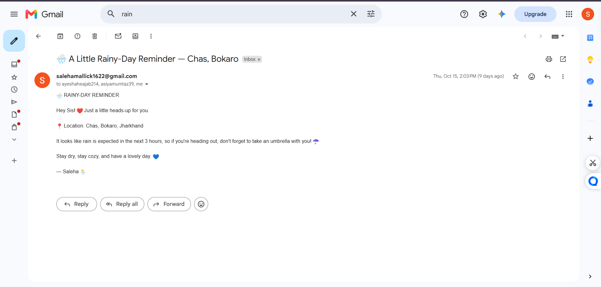

# 🌧️ Rain Alert — Automated Weather Email Notification

A Python automation project that checks the weather forecast and sends a personalized email notification when rain is expected. It runs automatically through **GitHub Actions**, so there's no need to run the script manually every day.

## ✨ Features

- 🌦️ Fetches weather forecast data using the OpenWeatherMap API
- ☔ Checks upcoming weather conditions for expected rain
- 📩 Sends personalized rain alert emails through Gmail SMTP
- 🤖 Runs automatically on a scheduled GitHub Actions workflow
- 🔐 Protects sensitive credentials using GitHub Secrets

## 📩 Sample Email Notification

Here's an example of the actual email sent by my Rain Alert automation.

*The notification includes the location, expected rainfall timeframe, and a friendly reminder to carry an umbrella.*

## 🛠️ Technologies Used

- **Language:** Python
- **HTTP Requests:** Requests
- **Weather Data:** OpenWeatherMap API
- **Email Notifications:** SMTP / Gmail
- **Automation & Scheduling:** GitHub Actions
- **Credential Management:** GitHub Secrets

## ⚙️ How It Works

1. The scheduled GitHub Actions workflow runs the Python script.
2. The script requests weather forecast data from OpenWeatherMap.
3. It checks whether rain is expected in the upcoming forecast.
4. If rain is expected, it sends an email notification with the relevant weather details.

## 🔐 Environment & Security

API keys and email credentials are stored securely as GitHub Actions Secrets rather than being hardcoded in the source code.

## 🚀 Project Outcome

Built a working, scheduled Python automation that checks weather forecasts and delivers email alerts without requiring manual execution.

## 👩‍💻 Author

**Saleha Sanober**

[GitHub Profile](https://github.com/Saleha78)

---

⭐ If you find this project interesting, feel free to explore the repository!
